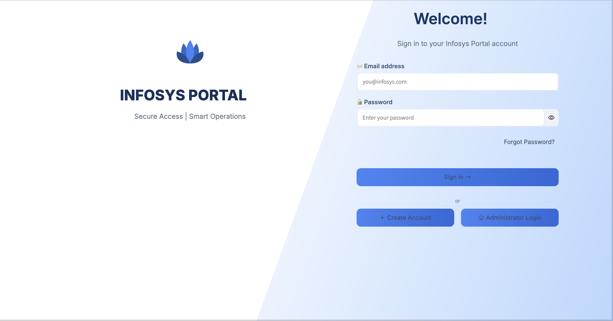
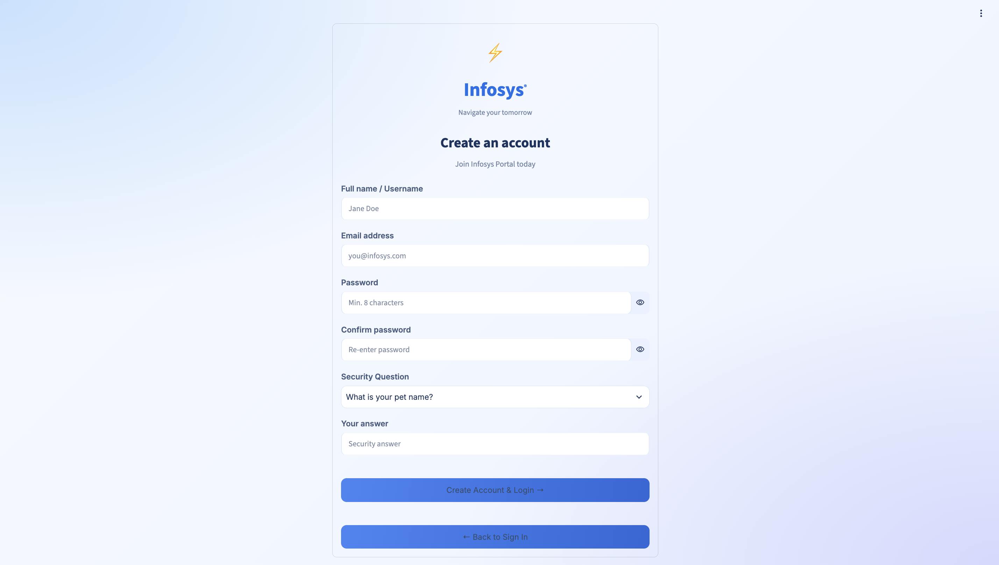

# Milestone 1: Secure Authentication System

## Project Overview

The Secure Authentication System is a Python-based web application developed as part of Infosys Springboard Internship 7.0 – Milestone 1.

The project provides a user authentication and account recovery system with a simple web interface. It allows users to register, log in, recover forgotten passwords, verify their identity through email OTP, and access dashboards based on their roles.

The primary objective is to demonstrate authentication workflows, secure password storage, token-based authentication, database integration, and email-based verification in a web application.

## Objectives

- Develop a user-friendly authentication interface.
- Implement user registration and login functionality.
- Store passwords securely using hashing.
- Implement JWT-based authentication.
- Provide multiple password recovery options.
- Enable email OTP verification.
- Maintain user information in a database.
- Provide separate user and administrator dashboards.
- Handle application credentials securely using environment configuration and Colab Secrets.

## Features

### 1. User Registration
Allows new users to create an account by entering the required details. The application processes the registration information and stores account data in the database.

### 2. User Login
Allows registered users to sign in using their credentials. The application validates the credentials before granting access.

### 3. Secure Password Storage
Uses bcrypt to hash passwords before storing them, avoiding the storage of readable passwords in the database.

### 4. JWT-Based Authentication
Uses JSON Web Tokens (JWT) to support token-based authentication after successful login.

### 5. Forgot Password — Security Question
Provides a password recovery option in which users answer their configured security question to verify their identity.

### 6. Forgot Password — Email OTP
Provides an email-based recovery option using a temporary one-time password (OTP). The application validates the submitted OTP as part of the recovery process.

### 7. User Dashboard
Provides a dashboard for authenticated regular users, with access to the features intended for their role.

### 8. Admin Dashboard
Provides a separate administrative interface for users with the appropriate administrative privileges.

### 9. Database Integration
Uses SQLite to persist user account information and other authentication-related data.

### 10. Email Notifications
Uses SMTP to send OTP emails through the configured email service.

## Technology Stack

| Technology | Purpose |
|---|---|
| Python | Application logic and backend processing |
| Streamlit | Web interface and dashboard development |
| SQLite | Database storage |
| bcrypt | Password hashing |
| PyJWT | JWT creation and verification |
| SMTP / smtplib | Email OTP delivery |
| pyngrok | Public tunnel for accessing the running application |
| Google Colab | Development and execution environment |
| Plotly | Interactive charts, where used by the application |

## System Workflow

1. The user opens the authentication application.
2. A new user registers, or an existing user logs in.
3. During login, the application checks the submitted credentials against the stored account information.
4. Password verification is performed using the stored bcrypt hash.
5. After successful authentication, JWT-based authentication is used as configured by the application.
6. Users who forget their passwords can use the security-question or email-OTP recovery option.
7. After successful verification, the password recovery process proceeds according to the selected method.
8. Authenticated users access the dashboard permitted by their role.

## Security Measures

- **Password hashing:** Uses bcrypt to protect stored passwords.
- **Token-based authentication:** Uses JWT for authentication-related token handling.
- **Credential management:** Stores sensitive configuration values in Google Colab Secrets rather than hardcoding them in the notebook.
- **Email verification:** Uses OTP verification as part of the email-based recovery workflow.
- **Role separation:** Provides distinct user and administrator interfaces.

Security depends on the implementation and configuration of these mechanisms; the presence of a feature alone does not guarantee complete protection.

## Application Configuration

The notebook uses the following Colab Secrets:

- `NGROK_AUTHTOKEN` — ngrok authentication.
- `JWT_SECRET` — secret used for JWT signing and verification.
- `EMAIL_ADDRESS` — configured email sender address.
- `EMAIL_PASSWORD` — credential used for email authentication.

Sensitive values should never be committed to GitHub or included in screenshots or notebook outputs.

## Project Structure

```text
infosys-franchise-ai/
└── Milestone1/
    ├── Milestone_1_Authentication.ipynb
    ├── README.md
    └── screenshots/
        ├── login.png
        ├── createAccount.png
        ├── forgot password.png
        ├── Security Question.png
        ├── OTP verification.png
        ├── User dashboard.png
        ├── Admin login.png
        └── Admin Dashboard.png
```

## Screenshots

### Login


### Signup


### Forgot Password


### Forgot Password — Security Question


### Forgot Password — Email OTP


### User Dashboard


### Admin Login


### Admin Dashboard


## Conclusion

This milestone demonstrates the implementation of a web-based authentication system with registration, login, password recovery, email OTP verification, database integration, and role-specific dashboards. It combines Python application development with authentication and security concepts to provide a practical foundation for building secure web applications.
