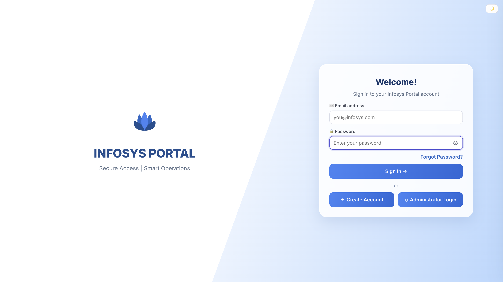
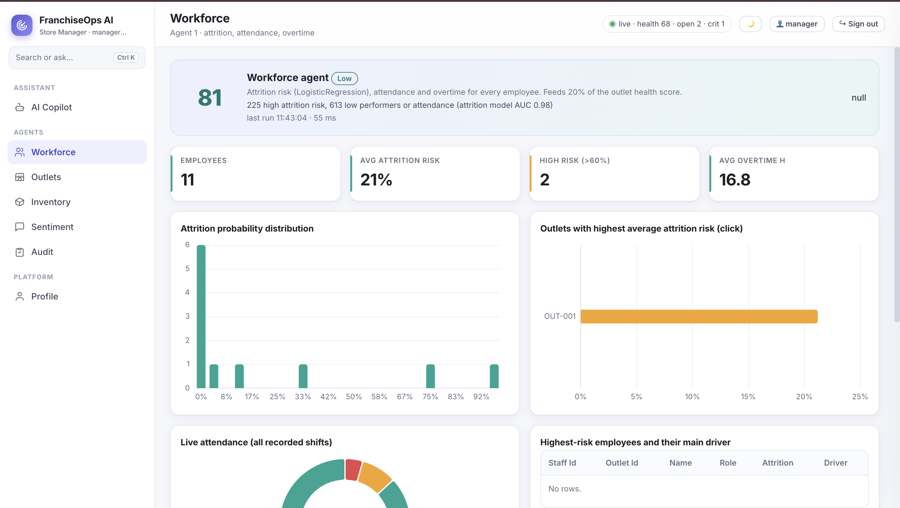
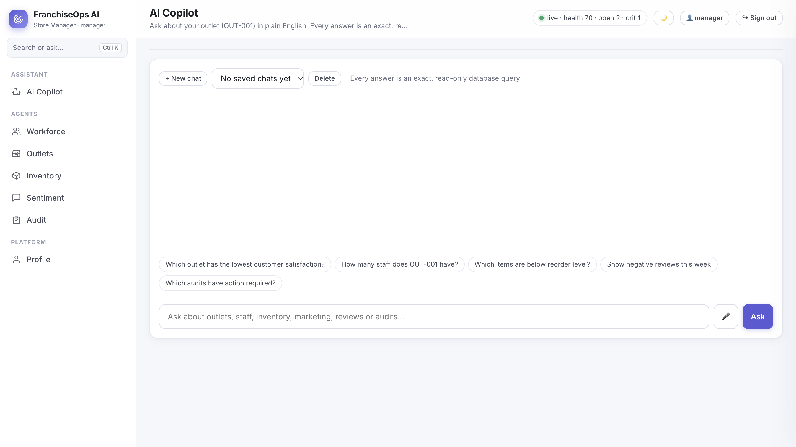
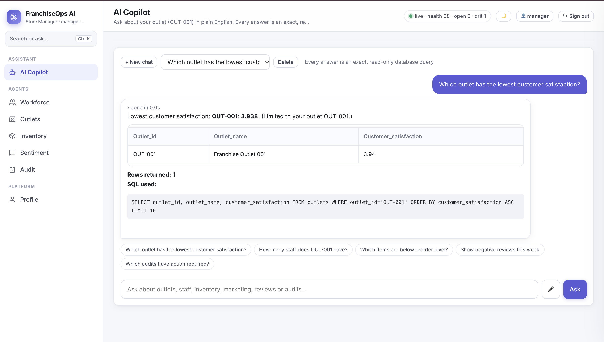
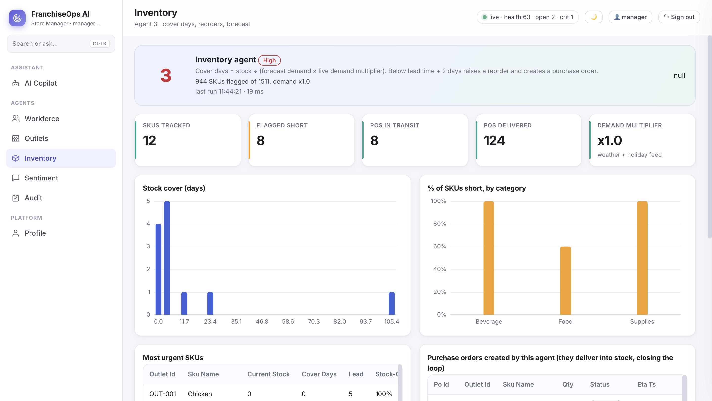

# FranchiseOps AI Copilot – Milestone 2

## 1. Project Overview

**FranchiseOps AI Copilot** is an AI-powered Franchise Management System developed as part of the **Infosys Springboard Internship 7.0 – Batch 4.0**.

The system helps franchise businesses monitor operations, analyze performance, access business information, and make data-driven decisions through an interactive dashboard and an AI-powered SQL Copilot.

Milestone 2 focuses on extending the existing Milestone 1 application by integrating authentication, improving navigation, enhancing the Copilot experience, and preparing the system for role-based access.

## 2. Objectives

- Integrate the authentication system developed in Milestone 1.
- Provide secure login and user registration.
- Build an interactive and responsive franchise management dashboard.
- Provide navigation between different application modules.
- Implement an AI Copilot that understands business-related questions.
- Retrieve answers from the franchise database using SQL queries.
- Display generated SQL queries and query results.
- Support role-based access management as a separate project responsibility.
- Maintain existing application functionality while introducing new features.

## Technology Stack

| Category | Technologies |
|---|---|
| Programming Language | Python |
| Backend Framework | FastAPI |
| Frontend | HTML, CSS, JavaScript |
| Database | SQLite |
| Authentication | JWT, bcrypt |
| Data Processing | Pandas, NumPy |
| Machine Learning | Scikit-learn, SciPy |
| Sentiment Analysis | VADER |
| Data Visualization | Matplotlib, Apache ECharts |
| Maps | Leaflet, TopoJSON |
| PDF Processing | pdfplumber |
| HTTP Requests | Requests |
| Email Service | SMTP |
| Application Server | Uvicorn |
| Development Environment | Google Colab |
| Deployment and Tunnelling | Google Colab Proxy, pyngrok |
| Version Control | Git, GitHub |

### 4.1 Authentication

The authentication module extends the login functionality developed in Milestone 1.

**Features include:**

- User login using email and password.
- New user registration.
- Password hashing using bcrypt.
- Password validation.
- Show/hide password option in the login interface.
- Forgot password functionality using a security question.
- Password reset.
- JWT-based authentication sessions.

### 4.2 Dashboard

The dashboard provides a centralized interface for accessing franchise operations information.

**It includes:**

- Franchise operations overview.
- Performance monitoring.
- Interactive dashboard components.
- Navigation between application modules.
- Copilot access.
- Workforce-related information.

### 4.3 AI Copilot

The AI Copilot understands natural-language questions and retrieves answers from the franchise database using SQL queries.

It supports business-related questions concerning outlets, workforce, inventory, marketing, customer feedback, and audits. It also handles greetings and provides suggestions for unsupported questions.

**The following are 18 sample questions for demonstrating the Copilot:**

1. Which outlet has the lowest customer satisfaction?
2. How many staff members work at OUT-010?
3. Which items are below the reorder level?
4. Which campaign has the best ROI?
5. Show negative customer reviews this week.
6. Which audits require corrective action?
7. List the top 5 outlets by revenue.
8. Which outlets have the highest staff attrition?
9. Which items have the highest stock-out risk?
10. Which campaign has the most conversions?
11. Which outlet has the most negative customer feedback?
12. Show all pending compliance issues.
13. Which outlets are the most profitable?
14. Which employees have a high attrition risk?
15. Which outlet has the lowest stock cover?
16. What is the total marketing budget by channel?
17. What is the average customer rating by outlet?
18. Which outlets have the lowest audit scores?

**Note:** These are sample demonstration questions. The exact questions supported depend on the SQL patterns implemented in `analyst.py`. Use the application's tested question patterns when demonstrating the Copilot.

### 4.4 Navigation and Routing

The application uses FastAPI routes to navigate between the login interface, dashboard, and backend API endpoints.

| Route | Purpose |
|---|---|
| `/login` | Displays the login page |
| `/` | Main application dashboard |
| `/api/health` | Checks server availability |
| `/api/auth/signup` | User registration |
| `/api/auth/login` | User login |
| `/api/auth/me` | Retrieves authenticated user information |
| `/api/auth/logout` | Logs out the user |
| `/api/auth/forgot` | Password recovery |
| `/api/page/copilot` | Copilot page data |
| `/api/page/workforce` | Workforce page data |
| `/api/chats` | Chat-related data |
| `/api/stream` | Application streaming endpoint |

*Note: API routes are backend endpoints, whereas `/` and `/login` are browser-facing pages.*

### 4.5 Role-Based Access Management

The overall project requirements identify five user roles:

1. Admin
2. Franchise Owner
3. Store Manager
4. Staff
5. Auditor

Role-based permissions for pages, database access, and actions are being handled separately by the designated team member.

This README does not claim that RBAC has been completed as part of the authentication integration.

## 5. Copilot – Example Business Questions

The Copilot supports database-backed business questions through predefined SQL question patterns.

Examples of the intended natural-language interaction include:

- Show me the overall franchise performance.
- What is the current workforce status?
- Show the available franchise information.
- Give me the relevant business performance details.
- Retrieve the records matching my question.
- Show the database results for this query.

**Important:** The exact questions supported depend on the SQL patterns implemented in `analyst.py`. These examples are illustrative; use the application's tested question patterns when demonstrating the Copilot.

When a supported question is submitted, the system displays the corresponding SQL query and database results. Unsupported questions receive a helpful response with suggestions for supported queries.

## 6. Application Screenshots

### 6.1 Login Page



### 6.2 Main Dashboard



### 6.3 AI Copilot Interface



### 6.4 Copilot SQL Query and Results



### 6.5 Navigation and Application Modules



## 7. Project Structure

The intended Milestone 2 repository structure is:

```text
Milestone2/
│
├── README.md
├── FranchiseOps_Copilot_Login_Integrated.ipynb
│
└── images/
    ├── login-page.png
    ├── dashboard.png
    ├── copilot.png
    ├── copilot-results.png
    └── navigation.png
```

The application source code generated and executed in the notebook is organized as follows:

```text
app/
│
├── server.py
├── auth.py
├── db.py
├── config.py
├── analyst.py
├── qa.py
├── live_engine.py
├── worker.py
│
└── static/
    ├── index.html
    ├── login.html
    ├── app.js
    ├── login.js
    ├── style.css
    └── vendor/
```

## 8. Installation and Execution

### Step 1: Clone the Repository

```bash
git clone <repository-url>
cd <repository-name>
```

### Step 2: Install Dependencies

```bash
pip install fastapi uvicorn bcrypt PyJWT email-validator pandas
```

Install any additional dependencies required by the application.

### Step 3: Prepare the Application

Ensure that the application files, static assets, and database are available in the expected directories.

### Step 4: Start the FastAPI Server

```bash
cd app
uvicorn server:app --host 0.0.0.0 --port 8000
```

### Step 5: Open the Application

Open the following address in your browser:

```text
http://localhost:8000/login
```

After successful authentication, the user can access the main application.

*For Google Colab execution, use the notebook's server-startup and Colab proxy-link cells instead of opening localhost directly.*

## 9. Testing

The existing Copilot functionality was tested for:

- Supported SQL question patterns.
- Question wording and spelling normalization.
- SQL query execution.
- Query result display.
- Row-count display.
- Greeting detection.
- Unsupported question handling.
- Suggestions for unsupported questions.

The authentication module includes login, registration, and password recovery endpoints. Complete end-to-end authentication testing should be performed before considering the integration production-ready.

## 10. Milestone 2 Deliverables

- Integration of the Milestone 1 authentication functionality.
- Login and registration interface.
- Password hashing and JWT authentication.
- Password recovery functionality.
- Existing FranchiseOps dashboard retained.
- AI SQL Copilot functionality retained.
- Application navigation and routing.
- Project documentation.
- Application screenshots.
- Preparation for separate RBAC integration.

## Team Members and Contributions

| Team Member | Contribution |
|---|---|
| Kaushik B Narayana | Role-Based Access Control (RBAC) Integration |
| Moghitha B | Login and Authentication Integration, AI Copilot Enhancement |
| Pullaiahgari Lahari | Streamlit to FastAPI Integration |  

## 11. Conclusion

Milestone 2 extends the FranchiseOps AI Copilot by integrating authentication into the existing franchise management application while retaining its dashboard and database-driven Copilot capabilities.

The application aims to provide a centralized platform where franchise users can access business information, interact with an AI-powered Copilot, and monitor operational performance through a structured interface.
